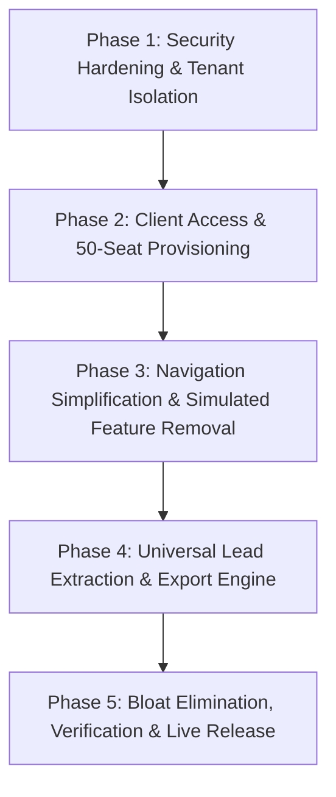

# USMAN AI GTM — MASTER PRODUCT CLEANUP & SIMPLIFICATION PLAN
## ARCHITECTURAL REORGANIZATION • CLIENT ACCESS • DATA ISOLATION • LEAD EXTRACTION SAAS

**Document Date:** November 12, 2026  
**Auditor / Lead Engineer:** Principal Software Architect & Full-Stack Systems Lead  
**Target Goal:** Transform USMAN AI GTM into a clean, simple, highly reliable B2B lead extraction SaaS with 50 administrator-provisioned client accounts, strict tenant isolation, empty initial workspaces, and zero fake or simulated features.

---

## 1. STRATEGIC MISSION OBJECTIVES

1. **Core Value Proposition**: A universal B2B lead extraction tool that allows paying clients across any industry (real estate, clinics, restaurants, IT, logistics, hospitality, manufacturing, accounting, etc.) to discover verified public businesses, websites, phone numbers, emails, addresses, and social links via official APIs and licensed public sources.
2. **Access Control**: Complete elimination of public self-registration. Controlled invitation-only access where an authorized administrator provisions up to 50 client seats with unique temporary credentials and forced password rotation on first login.
3. **Strict Data Isolation**: Every client workspace starts completely blank. Client A cannot read, query, update, delete, or export any data belonging to Client B. Isolation enforced on backend database queries (`WHERE workspace_id = ?`), not merely UI filters.
4. **Zero Fabrication**: Removal of all fake AI agent execution metrics, simulated Monte Carlo ARR forecasting, fabricated customer health scores, and fake chatbot replies.
5. **Streamlined Premium Navigation**:
   * **Client Navigation (5 items)**:
     1. Dashboard (`/app`)
     2. Lead Search (`/app/leads`)
     3. Saved Leads (`/app/saved-leads`)
     4. Exports (`/app/exports`)
     5. Account Settings (`/app/settings`)
   * **Admin Navigation (5 items)**:
     1. Admin Dashboard (`/app/admin`)
     2. Client Accounts (`/app/admin/clients`)
     3. System Health (`/app/admin/health`)
     4. API Configuration (`/app/admin/integrations`)
     5. Audit Logs (`/app/admin/audit-logs`)

---

## 2. PHASE-BY-PHASE IMPLEMENTATION PLAN



---

### PHASE 1: SECURITY HARDENING & STRICT CLIENT DATA ISOLATION

* **Target Endpoints**:
  * `GET /api/leads/{id}`
  * `PUT /api/leads/{id}`
  * `DELETE /api/leads/{id}`
  * `POST /api/leads/{id}/score`
  * `POST /api/leads/{id}/intent`
* **Defect**: Currently, `LeadService.get_lead_by_id(lead_id)` queries `SELECT * FROM leads WHERE id = ?` without comparing `workspace_id`. Any authenticated user can access any other client's lead by guessing the integer ID (Insecure Direct Object Reference).
* **Remediation**:
  1. Update `backend/app/services/lead_service.py` to enforce `workspace_id` in every single lead CRUD operation:
     ```python
     def get_lead_by_id(lead_id: int, workspace_id: int) -> Optional[Dict[str, Any]]:
         conn = get_db_connection()
         row = conn.execute("SELECT * FROM leads WHERE id = ? AND workspace_id = ?", (lead_id, workspace_id)).fetchone()
         conn.close()
         return dict(row) if row else None
     ```
  2. Implement role-aware override: allow users with `ADMIN` role cross-tenant viewing if explicitly authorized, but restrict all `USER` / `CLIENT` accounts strictly to their own workspace.
  3. Mirror this tenant-scoping logic inside Next.js serverless proxy routes (`app/api/leads/[id]/route.ts`).
  4. Ensure new client registrations auto-assign a dedicated private `workspace_id` with 0 initial leads, 0 initial deals, and 0 sample records.

---

### PHASE 2: CLIENT ACCESS OVERHAUL (REMOVE PUBLIC SIGNUP & ADD 50-SEAT PROVISIONING)

* **Eliminate Public Registration**:
  1. Remove or disable `/signup` page. Any direct navigation to `/signup` redirects to `/login?notice=invitation_only`.
  2. Update `components/marketing/Header.tsx`, `components/marketing/Footer.tsx`, `app/page.tsx`, and `app/pricing/page.tsx`:
     * Replace "Sign Up" / "Get Started Free" buttons with "Client Portal Login" (`/login`) or "Request Demo / Access".
  3. Update `app/app/layout.tsx`:
     * Change line 38 from `router.push("/signup")` to `router.push("/login")`.
  4. Secure `/api/auth/signup`:
     * Reject anonymous signup requests with `403 Forbidden` ("Public self-registration is disabled. Contact your administrator for an account.").

* **Build 50-Seat Admin Provisioning Engine**:
  1. **Database Schema Update (Additive & Non-Destructive)**:
     * Add column `must_change_password INTEGER DEFAULT 0` to `users` table in `usman_data_analytics.db` and `usman_luxury_engine.db`.
     * Add column `account_status TEXT DEFAULT 'ACTIVE'` to `users` table (`ACTIVE`, `SUSPENDED`, `REVOKED`).
     * Add table `client_profiles (id INTEGER PRIMARY KEY, user_id INTEGER, client_name TEXT, industry TEXT, max_leads_quota INTEGER DEFAULT 5000, notes TEXT, created_at TEXT)`.
  2. **Backend API Endpoints in `backend/app/api/admin.py`**:
     * `POST /api/admin/clients`:
       * Accepts: `client_name`, `email` (or unique username), `company`, `industry`, `lead_quota`.
       * Validates that total provisioned clients does not exceed 50.
       * Generates a 16-character cryptographically secure temporary password using `secrets.choice`.
       * Hashes password using standard `pbkdf2_sha256` with unique 16-byte random salt.
       * Sets `must_change_password = 1`.
       * Automatically provisions a dedicated, empty `workspaces` record for that client.
       * Returns temporary password **EXACTLY ONCE** in HTTP response for secure administrator handover.
     * `POST /api/admin/clients/{id}/reset-password`:
       * Generates a new temporary random password, hashes it, sets `must_change_password = 1`, and returns the password once to the admin.
     * `POST /api/admin/clients/{id}/status`:
       * Toggles client status between `ACTIVE` and `SUSPENDED`.
     * `DELETE /api/admin/clients/{id}`:
       * Safely revokes account with data-retention safety confirmation.
  3. **First-Login Password Rotation Dialog**:
     * When a client logs in with `must_change_password == 1`:
       * Modal appears blocking access to dashboard until they set a new permanent password (min 8 chars, 1 uppercase, 1 digit, 1 special character).
       * Upon successful update, `must_change_password` is set to 0.
  4. **Admin Client Management UI (`/app/admin/clients`)**:
     * Table displaying: Client ID, Name/Company, Login Email, Status Badge (`ACTIVE` / `SUSPENDED`), Leads Discovered, Created Date, Last Login, Actions.
     * "Provision New Client" modal with live quota counter (`X / 50 seats used`).
     * Secure "One-Time Credential Modal" showing temporary password with one-click copy button and clear warning that it will never be displayed again.

---

### PHASE 3: NAVIGATION SIMPLIFICATION & SIMULATED FEATURE REMOVAL

* **Simplify Layout Navigation (`app/app/layout.tsx`)**:
  * Replace the 18+ menu items with exactly two clean, role-gated navigation structures:
    ```typescript
    // Standard Client Navigation
    const clientNav = [
      { name: "Dashboard", href: "/app", icon: LayoutDashboard },
      { name: "Lead Search", href: "/app/leads", icon: Search },
      { name: "Saved Leads", href: "/app/saved-leads", icon: Database },
      { name: "Exports", href: "/app/exports", icon: Download },
      { name: "Account Settings", href: "/app/settings", icon: Settings },
    ];

    // Administrator-Only Navigation
    const adminNav = [
      { name: "Admin Overview", href: "/app/admin", icon: Shield },
      { name: "Client Accounts", href: "/app/admin/clients", icon: Users2 },
      { name: "System Health", href: "/app/admin/health", icon: Activity },
      { name: "API Configuration", href: "/app/admin/integrations", icon: Key },
      { name: "Audit Logs", href: "/app/admin/audit-logs", icon: FileText },
    ];
    ```
* **Decommission / Quarantine Simulated Pages**:
  * Remove links to:
    * `/app/revenue` (Monte Carlo ARR simulator)
    * `/app/customers` (Fake customer health)
    * `/app/ai-agents` (Simulated AI workforce)
    * `/app/abm` (Hardcoded target accounts)
    * `/app/workflows` (Fake automation canvas)
    * `/app/copilot` (Fake deal summary bot)
    * `/app/features-lab` & `/app/features` (Feature catalogs)
    * `/app/outreach/**` (All 10 cold email pages)
    * `/app/whatsapp` (Meta Cloud API companion)
* **Refactor Key Retained Pages**:
  * `/app` (Dashboard): Clean lead discovery overview, search history, saved leads count, and recent exports.
  * `/app/saved-leads`: Clean data table with stage filters, contact badges, notes, and 1-click CSV/XLSX export.
  * `/app/exports`: History of generated export files with download links and record counts.

---

### PHASE 4: UNIVERSAL B2B LEAD EXTRACTION & EXPORT ENGINE

* **Lead Extraction Enhancements (`app/app/leads/page.tsx` & `backend/app/services/lead_service.py`)**:
  * **Location Filtering**:
    * Country dropdown (193 countries with ISO codes).
    * State / Province text input.
    * City text input with top metropolitan city quick-tags.
  * **Business Categories & Industries**:
    * Real Estate & Property Developers
    * Healthcare, Medical & Dental Clinics
    * Technology, Software & IT Houses
    * Restaurants, Cafes & Hospitality
    * Hotels & Tourism
    * Manufacturers & Industrial
    * Wholesalers & Distributors
    * Retailers & E-Commerce
    * Accounting, Tax & Financial Advisory
    * Construction & Engineering
    * Logistics, Freight & Transport
    * Education & Training Institutes
    * Marketing, Advertising & PR Agencies
    * Legal & Law Firms
    * Custom Business Category keyword
  * **Extraction Fields**:
    * Business Name
    * Industry & Business Category
    * Country, State/Province, City, Full Public Street Address
    * Official Website URL & Website Reachability Status
    * Public Business Email
    * Honest Email Status: `FOUND` (found in public domain crawl/snippet), `UNVERIFIED` (public email not syntax/MX verified), `NOT DETECTED` (no public email listed). **NEVER claim verified without real MX check.**
    * Public Business Phone Number
    * Public Business WhatsApp Number (detected from wa.me / API links)
    * Social Media Profiles: LinkedIn Company URL, Instagram URL, Facebook Page URL, YouTube Channel URL
    * Business Description & Discovered Services
    * Data Source Platform (`Google Maps`, `Google Search`, `LinkedIn`, `Directories`, etc.)
    * Source Attribution URL & Timestamp
    * Deduplication Status: `UNIQUE` vs `DUPLICATE` (matching by normalized domain or phone)
* **Server-Side File Export Engine**:
  * Create `GET /api/leads/export`:
    * Query parameters: `format=csv` or `format=xlsx`, `workspace_id` (enforced from auth token).
    * Generates genuine CSV or Excel (.xlsx) file with professional headers.
    * Sets proper `Content-Disposition: attachment; filename="usman_leads_{date}.csv"`.
    * Enforces workspace isolation: only exports leads belonging to the caller's workspace.
    * Logs export event in `account_audit_logs`.

---

### PHASE 5: CODEBASE BLOAT ELIMINATION & RELEASE VERIFICATION

1. **Delete Duplicate `frontend/` Directory**:
   * Verify all needed files are in root `app/`, `components/`, and `lib/`.
   * Safely remove `frontend/` from repository to eliminate 115 duplicate files from git.
2. **Next.js Production Build**:
   * Execute `npm run build` and ensure exit code 0 across all cleaned routes.
3. **Execute Verification Test Suite**:
   * Test 1: Admin provisions client account & temporary password generated.
   * Test 2: Client logs in with temp password & is forced to change password.
   * Test 3: Client dashboard starts completely empty (0 leads, 0 deals).
   * Test 4: Client performs live search in Dubai/Lahore/London; real leads saved to Client workspace.
   * Test 5: Client B logs in; Client B cannot see or query Client A's leads.
   * Test 6: Client exports CSV and XLSX successfully.
   * Test 7: Anonymous user cannot register via `/signup` or `/api/auth/signup`.
4. **Deploy to Vercel Production**:
   * Commit verified changes to `main` and push to GitHub.
   * Probe live URL `https://lead-scraper-mxs5.vercel.app/` for HTTP 200 responses.

