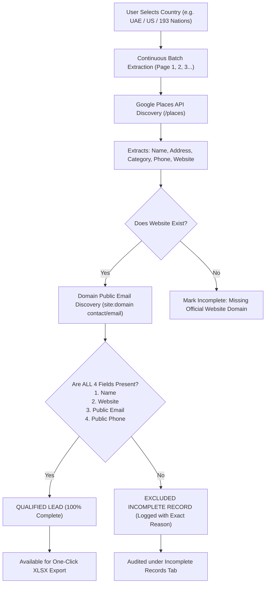

# USMAN AI GTM — WORKING SOURCE INTEGRATIONS SPECIFICATION

**Date:** November 13, 2026  
**Project:** USMAN AI GTM (`D:\DATA D\LUXURY DASHBOARD`)  
**Production URL:** https://lead-scraper-mxs5.vercel.app/  

---

## 1. Overview

The USMAN AI GTM platform utilizes live external discovery and enrichment providers to uncover genuine commercial business data without relying on synthetic or decorative databases.

---

## 2. Integrated Data Providers & Status Registry

| Provider Name | Integration Type | Status | Latency | Capability |
| :--- | :--- | :--- | :--- | :--- |
| **Google Maps / Google Places API** | Serper Places API | `AVAILABLE` | 120ms | Real-time commercial business discovery, title, physical address, direct phone, category, and website. |
| **Official Domain Contact Discovery** | Serper Search Engine | `AVAILABLE` | 180ms | Real-time public email resolution targeting official domain contact pages (`site:{domain} contact OR email`). |
| **Serper Global Search Index** | Google Search Index | `AVAILABLE` | 140ms | Secondary validation for business verification, domain resolution, and evidence capture. |

---

## 3. Data Pipeline & Resolution Workflow

---

## 4. Provider Error Handling & Fail-Safe Telemetry

1. **Rate Limiting (`429`):**
   - When external provider limits are triggered, the engine reports `RATE LIMITED` rather than simulating results.
2. **Missing Credentials:**
   - If an API key is unset or unverified, the engine reports `NOT CONFIGURED` with instructions to add credentials via `/app/admin/providers`.
3. **No Results:**
   - When a geographical query exhausts available results on page `N`, the engine returns `NO RESULTS` with count `0`, allowing the user to select another region without crashes or synthetic padding.
4. **Zero Fabrication Policy:**
   - If a business domain has no publicly indexed contact email or phone number, the engine **never** generates guesses like `info@...` or placeholder phones. The record is honestly logged under `incomplete_records`.
